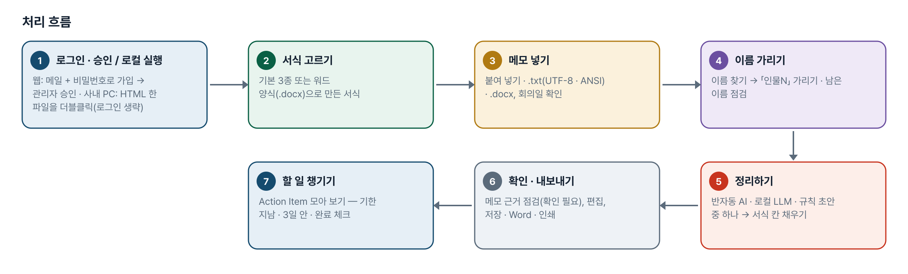
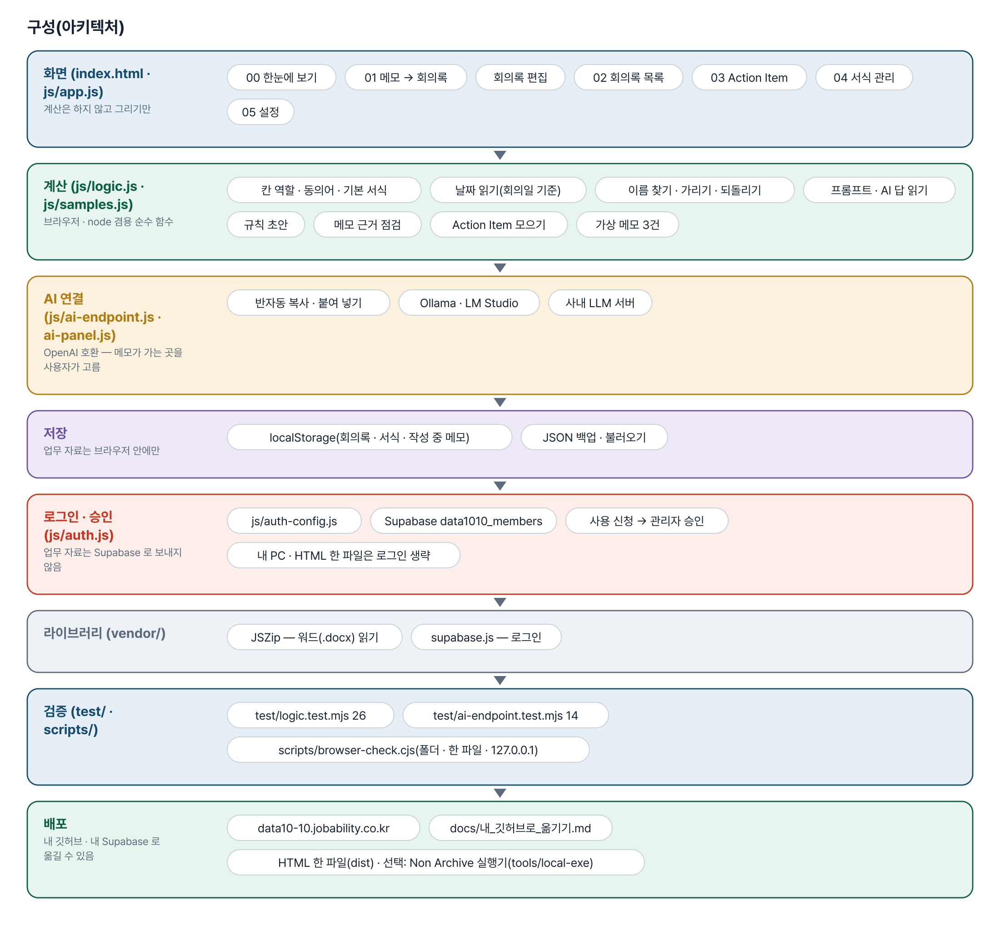
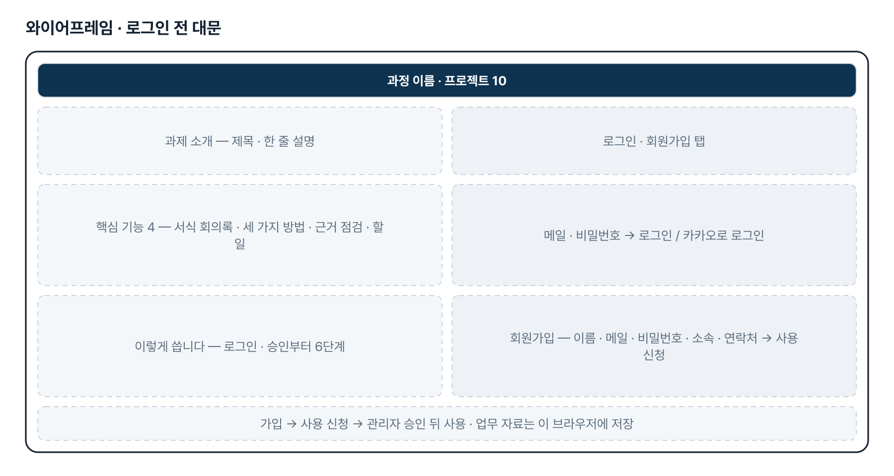
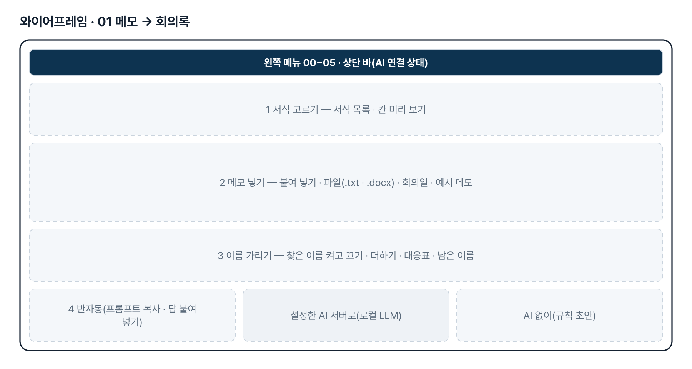
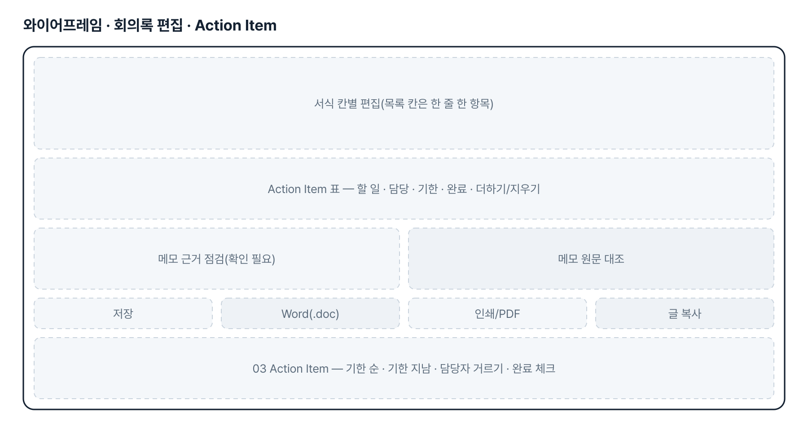
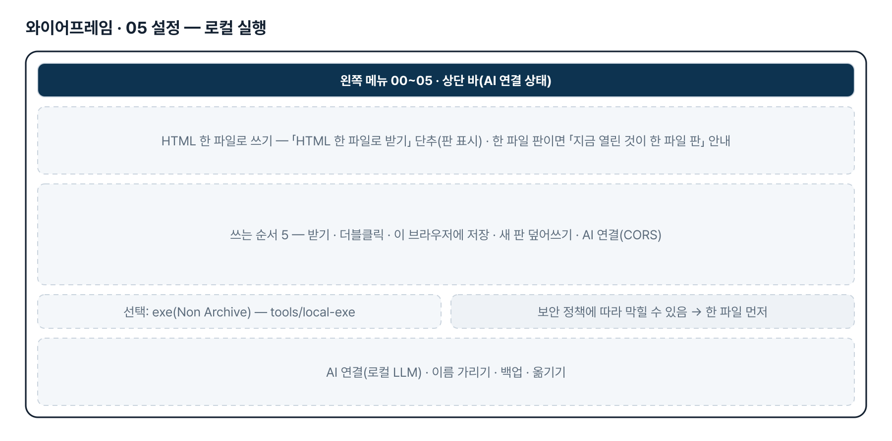
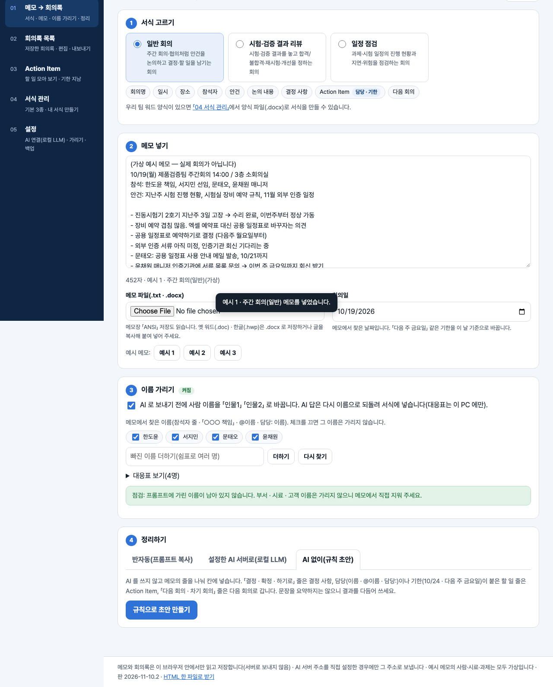

# AI 기반 회의록 요약 도우미 — 프로젝트 기획서 v2.1

- 기획: 나선준 · 작성일 2026-11-10 · 현장 데이터 디지털화 전문가과정 · 2차수 프로젝트 10
- 바로 쓰기: https://data10-10.jobability.co.kr/
- 워드 판: `docs/기획서/data10-10_나선준_AI기반회의록요약도우미_기획서_v2.1.docx`

## 개요

회의 직후 메모장 · 워드로 적은 메모와 회의록 서식을 넣으면 결정 사항과 Action Item(할 일 · 담당 · 기한)까지 서식 칸에 맞춰 정리하는 브라우저 도구입니다. 반자동 AI · 로컬 LLM · AI 없는 규칙 초안 중 하나로 정리합니다.

### 배경 · 현재 업무
- 회의가 끝나면 메모장이나 워드에 정리되지 않은 메모가 남고, 회의록 서식에 옮겨 적는 데 시간이 듭니다.
- 회사 양식마다 칸 이름(결정 사항 · 결론 · 합의 사항 등)이 달라 같은 방식으로 정리하기 어렵습니다.
- 사내 문서를 외부 AI 에 넣지 못할 수 있어 필요하면 로컬 LLM 을 써야 합니다.
- 결정 사항과 담당 · 기한이 회의록에 흩어져 있어 할 일을 챙기기 어렵습니다.

### 목표
- 메모(붙여 넣기 · .txt · .docx)와 회의록 서식을 함께 넣어 서식 칸에 맞춘 회의록을 만듭니다.
- 외부 AI · 로컬 LLM · AI 없이 중 회사 기준에 맞는 방법 하나는 반드시 쓸 수 있게 합니다.
- 메모에 없는 담당 · 기한 · 결정을 「확인 필요」로 표시해 AI 가 지어낸 내용을 거릅니다.
- 모든 회의록의 Action Item 을 기한 순으로 모아 기한 지남 · 3일 안 기한을 챙깁니다.

## 요구사항과 구현

| 기획서 요구 | 구현 |
|---|---|
| 메모장 · 워드로 작성된 회의 내용 넣기 | 붙여 넣기 · .txt(UTF-8 · 메모장 ANSI) · .docx(표는 한 행을 한 줄로). 옛 .doc · .hwp 는 2단계 |
| 회의록 서식을 같이 넣기 | 기본 서식 3종 + 워드 양식(.docx) · 양식 글에서 칸 뽑기, 칸마다 역할(결정 · Action Item · 다음 회의 …) |
| 서식에 맞춰 주요 내용 정리 | 반자동 프롬프트 · 답 읽기(JSON · 칸 이름 묶음 · 표) · 규칙 초안, 메모 근거 점검. 실제 정답 견본과 맞추기는 2단계 |
| 필요 시 로컬 LLM 활용 | OpenAI 호환 주소로 Ollama · LM Studio · 사내 LLM 서버, 모델 목록 불러오기, <think> 떼기 |
| 결정 · 담당 · 기한 챙기기 | Action Item 모아 보기 — 기한 지남 · 3일 안 · 담당자별, 완료 체크 |
| 회의 녹음 → 글 · 팀 공유 · 알림 | 3단계 — 범위 확정 후 |
| 사내 보안으로 웹 주소가 막힐 때 로컬 PC 에서 실행(exe · Non Archive) | HTML 한 파일(설치 · exe 없음, 더블클릭) 권장 · 선택으로 PyInstaller --onedir --noarchive 실행기 만드는 순서(tools/local-exe) |

## 주요 기능

- **서식에 맞춘 회의록** — 메모와 회의록 서식을 넣으면 칸 역할에 맞춰 회의명 · 안건 · 결정 · Action Item · 다음 회의를 채웁니다.
- **세 가지 정리 방법** — 프롬프트 복사(반자동) · 로컬 LLM 자동 보내기 · AI 없는 규칙 초안 중 회사 기준에 맞는 것을 고릅니다.
- **이름 가리기 · 근거 점검** — AI 로 보내기 전 이름을 「인물1」로 가리고, 메모에 없는 담당 · 기한 · 결정을 「확인 필요」로 표시합니다.
- **Action Item 모아 보기** — 모든 회의록의 할 일을 기한 순으로 모아 기한 지남 · 3일 안 기한 · 담당자별로 보고 완료를 체크합니다.
- **서식 관리** — 기본 3종을 고치거나 우리 팀 워드 양식(.docx) · 양식 글에서 칸을 뽑아 새 서식을 만듭니다.
- **편집 · 내보내기** — 칸별 편집, 메모 원문 대조, 저장 · Word(.doc) · 인쇄/PDF · 글 복사.
- **로그인 · 사용 승인** — 회사 메일이나 개인 메일로 가입해 사용 신청을 하면 관리자가 승인합니다.
- **로컬 실행(HTML 한 파일)** — 설정에서 HTML 파일 한 개를 받아 PC 에 두고 더블클릭해 씁니다. 설치 · 로그인 없이 열리고 외부 주소를 부르지 않습니다. 꼭 exe 가 필요하면 Non Archive(폴더형) 실행기를 만듭니다.

## 처리 흐름(파이프라인)

1. **로그인 · 승인 / 로컬 실행** — 웹: 메일 + 비밀번호로 가입 → 관리자 승인 · 사내 PC: HTML 한 파일을 더블클릭(로그인 생략)
2. **서식 고르기** — 기본 3종 또는 워드 양식(.docx)으로 만든 서식
3. **메모 넣기** — 붙여 넣기 · .txt(UTF-8 · ANSI) · .docx, 회의일 확인
4. **이름 가리기** — 이름 찾기 → 「인물N」 가리기 · 남은 이름 점검
5. **정리하기** — 반자동 AI · 로컬 LLM · 규칙 초안 중 하나 → 서식 칸 채우기
6. **확인 · 내보내기** — 메모 근거 점검(확인 필요), 편집, 저장 · Word · 인쇄
7. **할 일 챙기기** — Action Item 모아 보기 — 기한 지남 · 3일 안 · 완료 체크

## 구성(아키텍처)

- **화면 (index.html · js/app.js)** — 00 한눈에 보기 · 01 메모 → 회의록 · 회의록 편집 · 02 회의록 목록 · 03 Action Item · 04 서식 관리 · 05 설정
- **계산 (js/logic.js · js/samples.js)** — 칸 역할 · 동의어 · 기본 서식 · 날짜 읽기(회의일 기준) · 이름 찾기 · 가리기 · 되돌리기 · 프롬프트 · AI 답 읽기 · 규칙 초안 · 메모 근거 점검 · Action Item 모으기 · 가상 메모 3건
- **AI 연결 (js/ai-endpoint.js · ai-panel.js)** — 반자동 복사 · 붙여 넣기 · Ollama · LM Studio · 사내 LLM 서버
- **저장** — localStorage(회의록 · 서식 · 작성 중 메모) · JSON 백업 · 불러오기
- **로그인 · 승인 (js/auth.js)** — js/auth-config.js · Supabase data1010_members · 사용 신청 → 관리자 승인 · 내 PC · HTML 한 파일은 로그인 생략
- **라이브러리 (vendor/)** — JSZip — 워드(.docx) 읽기 · supabase.js — 로그인
- **검증 (test/ · scripts/)** — test/logic.test.mjs 26 · test/ai-endpoint.test.mjs 14 · scripts/browser-check.cjs(폴더 · 한 파일 · 127.0.0.1)
- **배포** — data10-10.jobability.co.kr · docs/내_깃허브로_옮기기.md · HTML 한 파일(dist) · 선택: Non Archive 실행기(tools/local-exe)

## 화면 구성(와이어프레임)

## 규칙 · 판정 기준

- 칸 이름은 동의어 표로 역할(결정 · Action Item · 다음 회의 …)을 짐작하고, 사용자가 바꿀 수 있습니다.
- 규칙 초안: 「결정 · 확정 · 하기로」 줄 → 결정 사항, 담당(이름 · @이름 · 담당:)이나 기한이 붙은 줄 → Action Item, 「다음 회의」 줄 → 다음 회의. 문장 요약은 하지 않습니다.
- 기한은 메모를 정리하는 날이 아니라 회의일 기준으로 읽습니다(「다음 주 금요일」 등). 1.5배 · 3.2% · 5/5 같은 수는 날짜로 읽지 않습니다.
- 메모 근거 점검: 담당 이름이 메모에 없거나, 기한이 메모의 날짜 표현과 맞지 않거나, 결정 · 할 일 문장이 메모 낱말과 많이 다르면 「확인 필요」.
- 이름 가리기는 긴 이름부터 「인물N」으로 바꾸고, 되돌릴 때는 숫자 전체를 한 번에 봅니다. 보내기 직전 남은 이름을 다시 찾습니다.
- AI 답은 JSON · 칸 이름 묶음 · 마크다운 표를 모두 읽고, <think>…</think> 는 떼어 냅니다.

## 검증

- 계산 규칙 테스트 26개 통과
- node test/logic.test.mjs 26개 — 가상 메모 3건을 정답 견본과 비교, 다른 서식, ANSI · 워드 파일, 워드 양식 → 서식, AI 답 3가지 모양, 망가진 답, 지어낸 담당 · 기한 · 결정 표시, Action Item, 내보내기, 저장 형식, HTML 한 파일(낡지 않음 · 외부 파일 없음 · 같은 판 · 스크립트 끊김 없음).
- node test/ai-endpoint.test.mjs 14개 — Ollama · LM Studio 주소, https 페이지 → localhost 경고, file:// 허용, 파일로 열었을 때 사내 서버 CORS(Origin: null) 경고.
- 일부러 깨뜨려 확인: 이름 되돌리기 · 가리기 · 「미정 · 검토 중」 거르기(1단계), dist 낡음 · fresh-guard file:// 생략 · 스크립트 끊는 글자 · CORS 경고(v2.1)를 빼면 해당 시험이 실패합니다.
- scripts/browser-check.cjs — 폴더(file://) · HTML 한 파일(외부 요청 끊음) · run_local.py(127.0.0.1) 세 방식, 1280 · 390 · 360px, 가로 넘침 0 · 콘솔 오류 0.

## 이번 판에서 하지 않는 것

- 업무 자료(회의록 · 서식 · 메모)는 아직 팀 공유 DB 가 아니라 이 브라우저에 저장합니다. JSON 백업으로 옮깁니다.
- 실제 회의록 서식 · 메모 · 완성 회의록(정답 견본)을 아직 받지 않아 모두 가상 예시로 맞췄습니다.
- 실제 로컬 LLM(Ollama)으로 끝까지 보내는 확인은 하지 않았습니다 — 요청 · 응답 모양은 가짜 서버 시험으로 확인했습니다.
- 옛 워드(.doc) · 한글(.hwp) 읽기, 회의 녹음 → 글, 알림은 하지 않습니다.
- Windows 실행 파일(exe)은 개발 PC(macOS)에서 만들 수 없어 만들어 보지 않았습니다 — Windows 에서 tools/local-exe/build_exe.bat 로 만듭니다. 회사 보안 정책에 따라 이것도 막힐 수 있어 HTML 한 파일을 먼저 권합니다.
- HTML 한 파일 · 실행기 · 웹 주소는 브라우저 저장소가 서로 따로입니다(백업 JSON 으로 옮김). 파일로 열면 사내 AI 서버가 Origin: null 요청을 허용해야 자동 보내기가 됩니다.

## 다음 단계

- 팀 공유 저장 — 회의록과 Action Item 을 팀이 함께 보기(요청자 Supabase)
- 실제 서식 · 메모 · 정답 견본으로 규칙과 프롬프트 맞추기, 회의 종류별 필수 칸 빠짐 경고
- 보안 기준에 맞춘 기본 방법(로컬 LLM) 정하기와 PC 사양에 맞는 모델 권장
- 옛 워드(.doc) · 한글(.hwp) 읽기, 지난 회의록 이어 보기

## 버전 이력

- **v2.1** (2026-11-10) — 로컬 실행 — HTML 한 파일(dist/data10-10_회의록요약도우미.html, 설치 · exe 없이 더블클릭) · 설정의 「HTML 한 파일로 받기」 / 선택: Non Archive 실행기(tools/local-exe — PyInstaller --onedir --noarchive, 내 PC 127.0.0.1 에서만 열림) / 파일로 열었을 때 사내 AI 서버 CORS(Origin: null) 안내
- **v2.0** (2026-11-10) — 최종 기획서 — 파이프라인 · 아키텍처 · 와이어프레임 정리 / 로그인 · 사용 신청 · 관리자 승인(요청자 Supabase 로 옮길 수 있게) / 로그인 전 대문
- **v1.2** (2026-11-08) — jobability.co.kr 새 주소로 옮김
- **v1.1** (2026-10-27) — 판 맞추기 — 모든 js·css ?v= · fresh-guard · 옛 파일과 새 파일이 섞이면 새로고침 안내 / 리포 비공개 전환 안내(2026-10-26)
- **v1.0** (2026-10-20) — 1단계 — 서식 · 메모 · 이름 가리기 · 세 가지 정리 방법 · 편집 · 내보내기 · Action Item / 가상 메모 3건 · 기획서 v0.1
